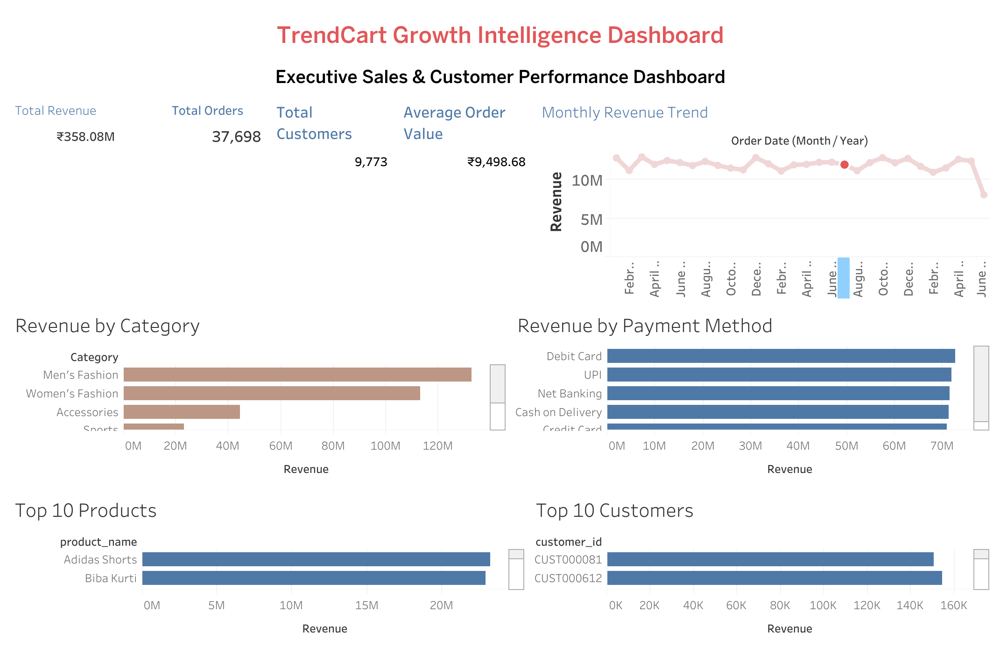

# TrendCart Growth Intelligence Platform

## Project Summary

The TrendCart Growth Intelligence Platform is an e-commerce analytics portfolio project developed using **Google BigQuery, SQL, Tableau Public, and GitHub**. It analyzes a simulated dataset containing over **55,000 transaction records** to explore revenue trends, customer purchasing behaviour, product performance, and order outcomes.

The project combines SQL-based business analysis with an executive dashboard to demonstrate how data can be used to monitor key performance indicators (KPIs) and support business decision-making.

**Important:** The dataset is simulated. Findings are illustrative and should not be interpreted as verified real-world retail behaviour.

---

## Business Problem

The project explores how an e-commerce business can use analytics to:

- Monitor revenue and order performance.
- Understand customer purchasing behaviour.
- Identify high-performing product categories and products.
- Examine order statuses, including returns and cancellations.
- Support data-informed business recommendations.

TrendCart is a simulated business scenario created for analytical practice, not a verified real retailer.

---

## Objectives

- Analyze monthly revenue trends.
- Calculate revenue, order counts, and average order value (AOV).
- Identify high-performing product categories and brands.
- Analyze revenue by payment method.
- Identify the top 10 products and customers by revenue.
- Examine order statuses and delivered-order performance.
- Build an executive Tableau dashboard.

---

## Dataset

The project uses a simulated e-commerce dataset organized into the following tables:

| Table | Description |
|---|---|
| Customers | Customer information, segments, and state |
| Orders | Order dates, order status, payment method, and customer identifiers |
| Order Items | Product-level selling prices and quantities |
| Products | Product names, categories, and brands |

**Dataset size:** 55,219+ transaction records, as documented for the project.

**Data status:** Simulated data used for portfolio and analytical practice. The original data-generation method has not been independently verified.

### Metric Definitions

- **Gross sales:** Sales calculated across the included order statuses, before excluding returns and cancellations.
- **Delivered-order revenue:** Revenue calculated from orders with `order_status = 'Delivered'`.
- **Delivered orders:** Distinct orders marked as `Delivered`.
- **Delivered average order value (AOV):** Delivered-order revenue divided by the number of distinct delivered orders.

Revenue is calculated using selling price multiplied by quantity. Refunds and partial returns are not deducted unless corresponding refund data and calculation logic are available.

---

## Tools & Technologies

- Google BigQuery
- SQL
- Tableau Public
- GitHub

---

## SQL Analysis

The file `sql/01_revenue_analysis.sql` contains 12 business analysis queries.

### Revenue Analysis

- Monthly delivered revenue
- Revenue by product category
- Revenue by payment method
- Average order value (AOV)
- Revenue by customer segment
- Revenue by brand
- Revenue by state

### Customer Analysis

- Order counts by status
- Monthly delivered-order counts
- Top 10 customers by delivered revenue

### Product Analysis

- Top 10 products by delivered revenue
- Top 10 products by quantity sold

Revenue-related queries filter for `Delivered` orders where appropriate. The order-status analysis includes all statuses to support the examination of returns and cancellations.

The SQL scripts and Tableau dashboard are separate analytical deliverables. Their outputs should not be assumed to match unless their data sources, reporting periods, and metric definitions have been verified.

---

## Dashboard Preview



*Note: The current dashboard screenshot displays gross sales metrics, including approximately ₹358.08M in revenue and 37,698 orders. These are not delivered-order figures. The SQL analysis separately calculates delivered-order metrics, so the figures should not be compared directly without aligning their definitions.*

---

## Tableau Public Dashboard

**[View the interactive dashboard on Tableau Public](https://public.tableau.com/app/profile/kamala.govindaraju/viz/trendcart/Dashboard2)**

*If the dashboard is unavailable, verify the published URL and its public-access settings.*

---

## Key Business Insights

The following findings are based on the supplied analysis of the simulated TrendCart dataset. They should be validated against the committed data and updated SQL outputs before being presented as final results. Revenue figures refer to delivered orders unless otherwise specified.

1. **Returns and cancellations:** The supplied analysis reports 17.0% returned orders and 16.5% cancelled orders. These statuses represent a substantial share of recorded orders. Investigate return reasons and cancellation causes before recommending operational changes.

2. **Category contribution:** Men's Fashion contributes approximately 37% and Women's Fashion approximately 32% of delivered revenue. Together, these categories account for around 69% of delivered revenue, making them important categories to monitor.

3. **Repeat purchasing:** The supplied analysis reports that approximately 78% of customers placed more than one order, averaging 2.7 orders per customer. This makes repeat purchasing worth examining, although simulated data cannot establish real-world retention behaviour.

4. **Revenue concentration:** The supplied analysis reports that the top 20% of customers account for approximately 41% of delivered revenue. This suggests revenue is not overwhelmingly concentrated in a small customer group, so loyalty strategies should be evaluated rather than assuming a VIP-only approach is sufficient.

5. **Order value and trends:** The supplied analysis reports delivered AOV of approximately ₹9,485. Monthly revenue should be compared across complete months; June 2025 is partial because the dataset ends on June 19, 2025.

**Data limitation:** These figures are supplied analytical findings, not independently re-calculated results in this README revision. Validate them against the committed dataset and updated SQL queries before treating them as confirmed outputs.

---

## Business Recommendations

- **Review returns and cancellations:** Investigate the reasons for returned and cancelled orders before recommending operational changes.
- **Monitor category performance:** Track Men's Fashion and Women's Fashion as major contributors to delivered revenue.
- **Evaluate retention initiatives:** Explore loyalty campaigns and repeat-purchase incentives, then measure their effectiveness using defined KPIs or controlled experiments.
- **Compare complete reporting periods:** Use full months for trend comparisons and clearly label June 2025 as a partial month.
- **Validate before acting:** Treat patterns in simulated data as analytical exercises, not confirmed evidence of real customer preferences, payment behaviour, or market demand.

---

## Repository Structure

```text
trendcart-growth-intelligence-platform/
├── dashboards/
├── data/
├── images/
│   ├── dashboard.png
│   └── README.md
├── sql/
│   └── 01_revenue_analysis.sql
├── .gitignore
├── LICENSE
└── README.md
```

*This structure reflects the documented project layout. Verify that each listed file exists in the repository before treating the tree as a complete inventory.*

---

## Author

**Kamala Govindaraju**

Growth Analytics | SQL | Google BigQuery | Tableau Public | Marketing Analytics

- **GitHub:** [View my projects](https://github.com/kamalagovindaraju1)
- **LinkedIn:** [Connect with me](https://www.linkedin.com/in/kamalagovindaraju/)
- **Substack:** [Read my case studies](https://kamalagovindaraju.substack.com/)
- **Tableau Public:** [Explore my dashboards](https://public.tableau.com/app/profile/kamala.govindaraju)
